Regressify Desktop lets you edit tests, run them, and review visual reports in one window. Your YAML and JSON files
stay the source of truth, so you can still edit or commit them outside the app.

New to Regressify? Start with [Getting started](/docs/getting-started/). On macOS, use `Cmd` where this page says
`Ctrl`, except `Ctrl+Space`. Click any screenshot to view it full screen.

## Install

The installer and in-app updates are Windows-only. On macOS and Linux, [build from source](/download/#source-heading);
Chromium downloads on your first run.

1. Download `Regressify-Desktop-Setup-N.N.N.N-x64.exe` from the [download page](/download/).
2. Run it. No administrator rights are needed. The installer isn't signed yet, so SmartScreen may warn you.

Setup installs to `%LOCALAPPDATA%\Programs\Regressify Desktop` and:

- adds desktop and Start-menu shortcuts;
- installs the `regressify` CLI and adds it to your user PATH (open a new terminal, and restart Windows Terminal or VS
  Code if they were open);
- adds **Open with Regressify Desktop** to the folder right-click menu (**Show more options** on Windows 11);
- downloads Chromium to `%LOCALAPPDATA%\regressify\chromium` if missing. The CLI shares it. Installed Chrome or Edge
  can't be used instead.

The test engine is built in, and each run uses its own background process.

**If Chromium fails to download**, the app still installs. Setup uses the system proxy. Set **Proxy** in Runs >
**Run settings**, then choose **More actions** (…) > **Install Chromium** and wait for "Chromium is ready". Running a
test or reference also retries.

**Uninstalling** removes the app, CLI, shortcuts, menu entries, and PATH entry. Workspaces, preferences, and the
Chromium cache are kept.

### Updates

Official Windows builds check at startup and every eight hours. You're only notified once the installer is downloaded
and its checksum matches. Updates never install on their own.

1. Click **Software updates** in the title bar. When an update is ready, a banner also offers **Install update**.
2. Click **Check for updates** to check now.
3. Click **Install and restart** (disabled during a run). If you have unsaved edits, choose **Save**, **Discard**, or
   **Cancel**.
4. The installer runs and your workspace reopens. It may ask you to close other windows but never force-closes them.

**Pause download** postpones retries for eight hours. **Copy details** appears after a failure. Closing the dialog
doesn't stop the download.

## Open a workspace

A workspace is the folder with your `regressify.yaml` and suites.

1. Start the app and click **Open workspace** ①.
2. Pick the folder.

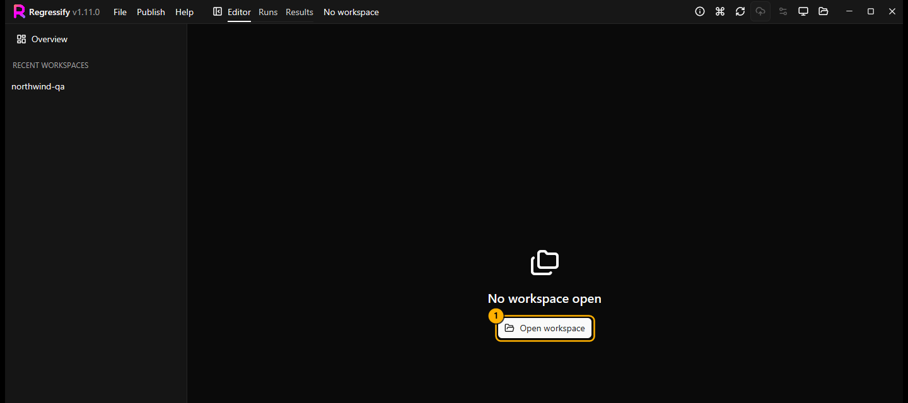

You can also open a workspace with:

- `Ctrl+O` or **Switch workspace** in the title bar
- **Open with Regressify Desktop** in the Explorer right-click menu
- **Recent Workspaces** on the taskbar icon
- `regressify-desktop <folder>` in a terminal

You can't switch workspaces during a run. **File** > **Close workspace** unloads the workspace but keeps the window
open.

Only open workspaces you trust. Configuration can run scripts in the browser, and the app is not a sandbox.

The app creates missing starter files (`regressify.yaml`, `common/` helpers and viewports, `visual_tests/`,
`.vscode/mcp.json`, and an `AGENTS.md` section) and never overwrites existing ones. For an example suite and schemas,
run **More actions** > **Initialize Workspace** in Runs (same as `regressify init`).

### Navigator

- Search suites and scenarios ① (`Ctrl+P`) by name, path, label, ID, or URL.
- **New suite** ② (`Ctrl+N`).
- **Selected** ③ shows only selected suites. Rows show queued, running, passed, and failed counts.
- **Scenarios** ④ lists the open suite. Hover for the full URL. Unlabelled scenarios get a display name from the URL
  that isn't saved.
- **Workspace files** ⑤ lists configuration and `common`. Text files up to 4 MiB open in the editor.

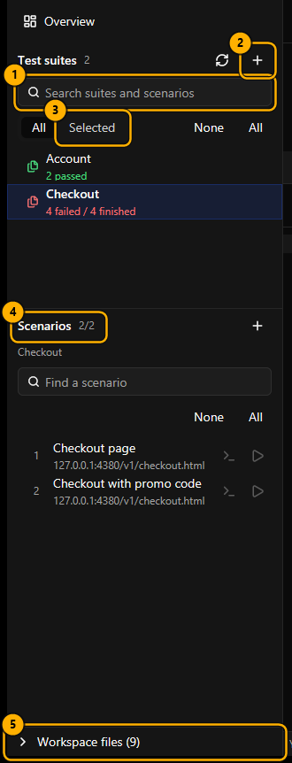

To edit other data files, such as a custom viewport file, use **File** > **Open configuration file**. The **File**
menu also has **Duplicate suite**, **Create viewport file**, and **Open in VS Code**.

`Ctrl+B` hides the navigator. Drag the divider to resize the panes.

| Action | Mouse | Keyboard |
| --- | --- | --- |
| Select one row | Click | `Up`, `Down`, `Home`, `End` |
| Add or remove a row | `Ctrl`+click | `Space` |
| Select a range | `Shift`+click | `Shift`+arrows |
| Select all, including rows hidden by search | **All** | |
| Select all visible rows | | `Ctrl+A` |
| Clear selection | Empty space or **None** | `Ctrl+Shift+A`, `Escape` |
| Open the focused row | Click | `Enter` |

With a search filter on, **All** also selects hidden rows, so check before you run. Clearing the selection keeps
unsaved edits.

### Overview

A workspace opens on **Overview** with totals, configuration issues, and each suite's status. Tick a suite to include
it in runs.

- **Suite details** ①: full suite details.
- **Edit** ②: open the suite in the editor.
- **Open Report** ③: open saved reports for the selected suites (shown once they have a saved run).
- **Clean up old test runs** ④: see [below](#clean-up-old-test-runs).
- **Run Reference** ⑤ and **Run Test** ⑥: run the selected suites.

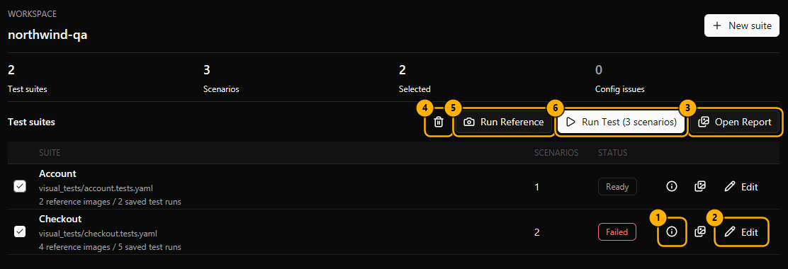

## Edit suites

### Create a suite

1. Click **New suite** or press `Ctrl+N`.
2. Type a **Filename** ①. `.tests.yaml` is added for you.
3. Click **Create** ②.

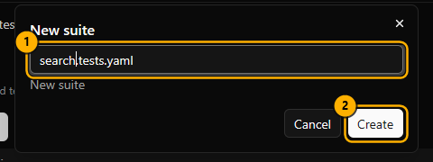

Names must end in `.tests.yaml`, `.tests.yml`, or `.tests.json` and can't start with a dot. `all`, `_snapshot`,
`_diagnostics`, `_landing`, and `states` are reserved. An invalid name keeps the dialog open.

Set a friendlier **Display name** in Fields > General. It doesn't rename the file, change the suite ID, or break CLI
filters and report links.

### Rename or delete a suite

Right-click a suite and choose **Rename suite** or **Delete suite** (`F2` or `Delete`). Neither works during a run.

- The **Rename suite** dialog sets the **Filename** and **Display name** separately. Changing only the display name
  moves nothing.
- Changing the filename of a suite without an explicit `id` also moves its references, saved runs, and reports.
- Deleting removes its references, test history, and local report entries. You confirm first, and **Undo** can't
  restore it. Deployed sites change only when you redeploy.
- Don't run CLI commands while a rename or delete is in progress.
- If a suite writes output to a custom folder the app has never used, that folder is left alone.

### Source, Fields, and Effective

**Source** is the raw file, **Fields** is a guided form, and **Effective** shows read-only final settings as the CLI
resolves them. Script and CSS files only have Source.

1. Open **Source** ①.
2. Press `Ctrl+Space` or click **Suggest** ② for suggestions (`Ctrl+Space` on macOS too).
3. Use **Find in source** ③ (`Ctrl+F`).
4. Toggle **Wrap** ④ and **Line numbers** ⑤.
5. Click **Save document** ⑥ or press `Ctrl+S`.

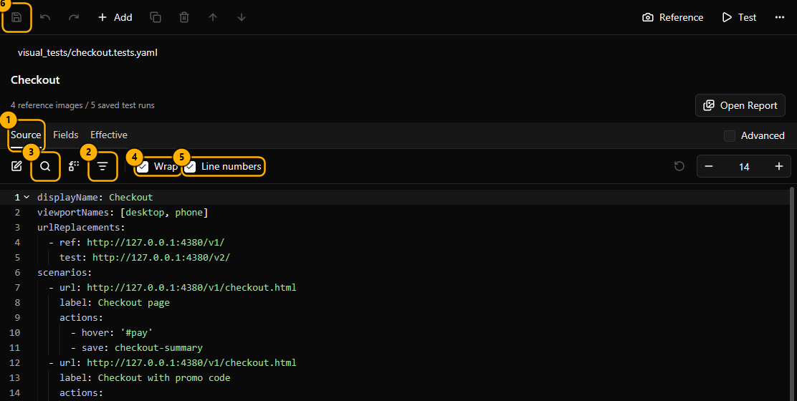

Pick a suggestion ① with the arrow keys, accept with `Enter` or `Tab`, or close with `Escape`. Hover a key for its
description and examples. Click an issue in the status strip to jump to it.

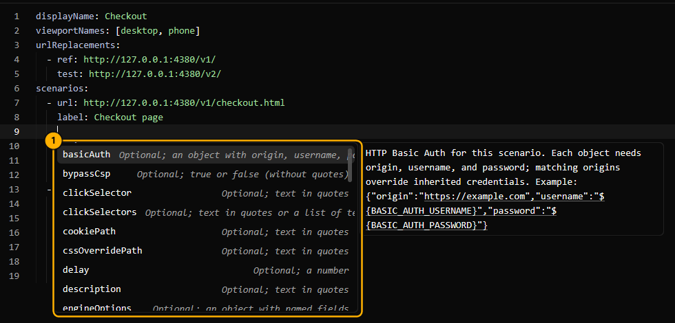

Keep credentials out of files. For `basicAuth`, use environment variables such as `${BASIC_AUTH_USERNAME}` and set them
before launching Regressify.

### Fields form

1. Select a scenario. **Fields** ① opens.
2. Search with **Find a setting** ② (`Ctrl+Shift+F`).
3. Turn on **Advanced** ③ for more options, or **Overrides only** ④ for values you set.
4. Open **Effective** ⑤ to see the final values.
5. Click **Run Scenario Test** ⑥ or **Run Scenario Reference** ⑦ to run this scenario on all its viewports.

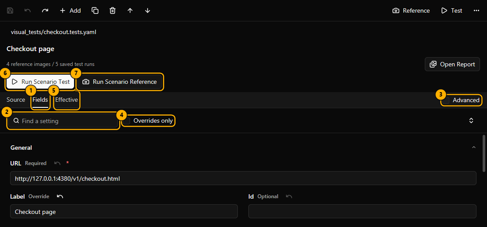

At least one viewport must stay selected. Number fields accept `Up` and `Down`.

A scenario setting you leave empty comes from the suite, then the workspace, then defaults, and the field says which.
Action and viewport fields don't inherit.

- A value you set shows **Override** ①, even `false`, `0`, or empty.
- **Use inherited value** ② removes it.

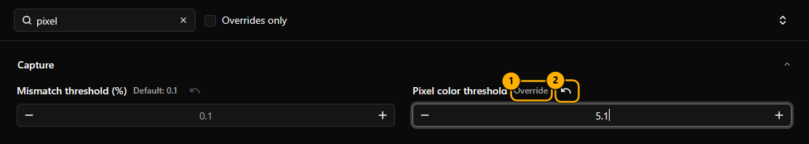

**Pixel color threshold** (0 to 100, default 5) sets how much a pixel's color must change before it counts as
different. Higher values ignore smaller changes. **Mismatch threshold (%)** sets how many pixels can differ before the
capture fails.

### Add actions

1. Click **Add action**.
2. Pick an action from a group ①.
3. Use **Move action earlier**, **Move action later**, **Duplicate action**, or **Remove action** on each step.

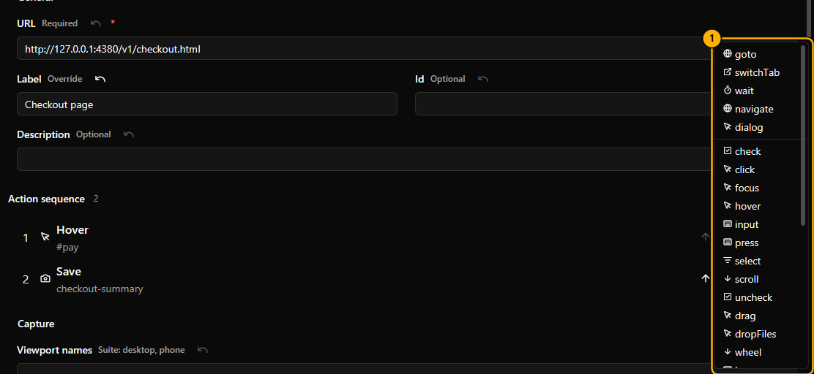

- The toolbar's **Add** menu adds a **Scenario**, a **Viewport**, or any of the 30 actions.
- Removing an action asks first, and you can undo any change.
- If a click opens a new tab, add a `switchTab` action with `new` after it. Use `previous` or `original` to go back.

### Save and undo

- `Ctrl+S` saves. YAML keeps comments. Fields edits re-format JSON.
- `Ctrl+Z` / `Ctrl+Shift+Z` undo and redo up to 100 steps.
- Drafts with errors can't be saved.
- **Save As** (`Ctrl+Shift+S`) never overwrites an existing file. Changing format drops YAML comments.

Leaving with unsaved edits offers **Save**, **Discard**, or **Cancel**. A failed save keeps the dialog and your edits.

If the file changes on disk and you have no unsaved edits, the app reloads it. If you have unsaved edits, the app
keeps them and shows **Reload from disk** (`Ctrl+R`):

- **Cancel** keeps your edits.
- **Discard** loads the version on disk.
- **Save As** saves your edits to a new file, so you keep both.

## Run tests

Press `Ctrl+2` for **Runs**.

| Button | Does |
| --- | --- |
| **Run Reference** | Captures baselines |
| **Run Test** | Captures and compares with baselines |
| **Approve Results** | Makes test results the new baselines |
| **Compare Results** | Compares an earlier run again |

**More actions** has **Build Report**, **Optimize Images**, **Install Chromium**, and **Initialize Workspace**.

### First run

1. Select suites on the **Suites** tab ① or in the navigator.
2. Click **Run Reference** ②.
3. Confirm "Replace reference images with new captures?" ③, or click **Cancel** ④.
4. When it finishes, click **Run Test**.

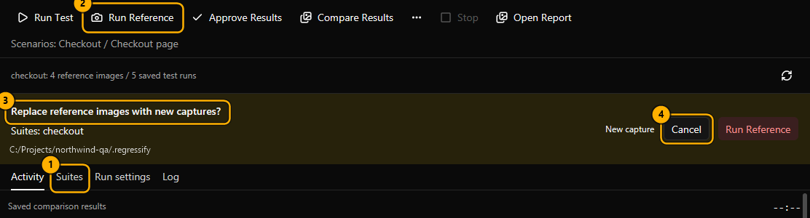

**Run Test** needs at least one successful reference per selected suite. With nothing selected, suite commands are
disabled; the app never quietly runs everything. **Run Reference**, **Approve Results**, and **Optimize Images** always
ask first.

To narrow a run, click scenarios in the navigator (`Ctrl`/`Shift` for several), or use a scenario row's **Run Test**
play button. The editor has **Run Suite Test** and **Run Suite Reference**. With unsaved edits you choose **Save and
continue**, **Run saved version**, or **Cancel**.

### Run settings

1. Open **Run settings** ①.
2. **Compare after test** ② compares captures right away.
3. **Run name (optional)** ③ targets a run for Approve and Compare. Empty means the last run, only if the same suites,
   scenarios, and output folder are selected. Type it to be sure what you approve.
4. **Browser download** ④: **Auto**, **Always**, or **Never**. With Never, run **Install Chromium** once.

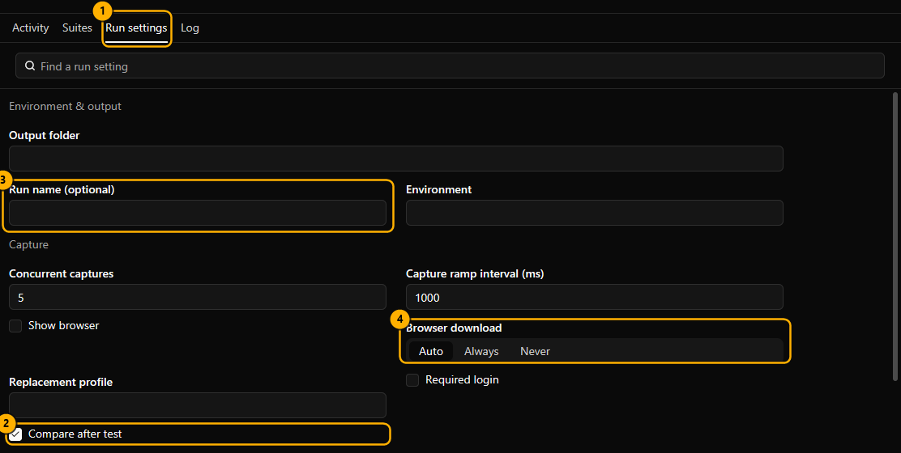

Use the same Regressify version on every QA machine, and recheck baselines when the browser version changes.

### Watch progress

1. Open **Activity** ① to see progress and the result for each scenario and viewport.
2. Turn on **Failures only** ② to hide passing rows.
3. Click a row ③ to open its log.

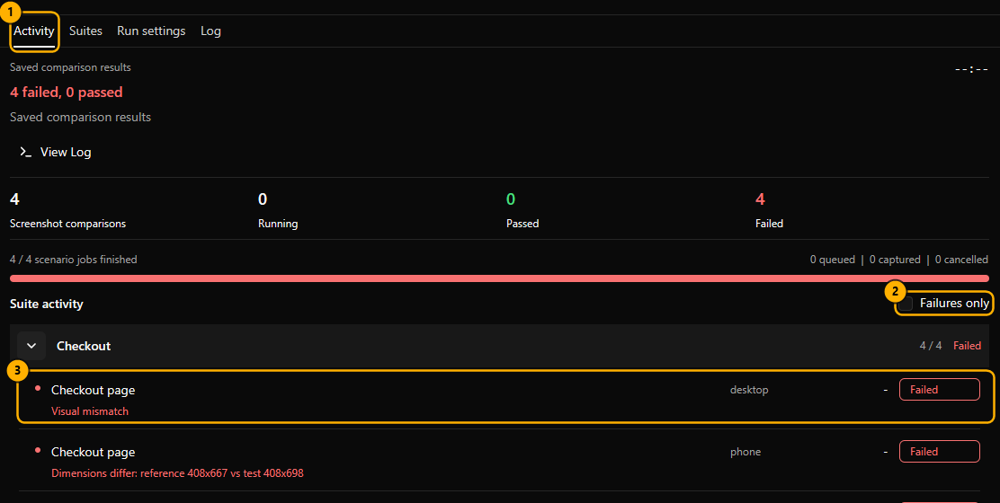

Counts are per screenshot: 4 scenarios on 3 viewports give 12. "Captured" isn't passed until compared. "3 failed, 5
passed" means the run worked; "Command failed" means a configuration, browser, or file-saving problem.

One command runs per window. **Stop** ends it and its browser. Closing the window stops the run first; close it
again once the run has stopped.

### Logs

1. Open **Log** ①, or click a row in Activity.
2. **Follow** ② keeps the newest entries visible. `Ctrl+F` searches.
3. **Copy displayed page** ③ copies the current page (500 entries). **Download complete filtered log** ④ saves every
   matching entry.

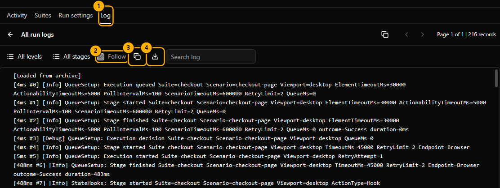

Logs never contain text you type into pages, but they can contain URLs, selectors, and script output. Check a log
before you share it.

When you reopen a workspace, Runs shows the last run's results without running anything.

## Review results

**Open Report** in Runs opens the report, comparing first if needed. **Results** (`Ctrl+3`) shows each suite's latest
completed full-suite run. Partial, stopped, or failed runs don't replace it; open those right after the run or by
**Run name**.

1. Filter with **Failed** ①, **All**, or **Passed**.
2. Pick a capture ②.
3. Choose a view ③: **Reference**, **Test**, **Diff**, **Side by side**, **Wipe**, or **Overlay**.
4. Use **Fit to window (0)** ④ or the zoom controls.

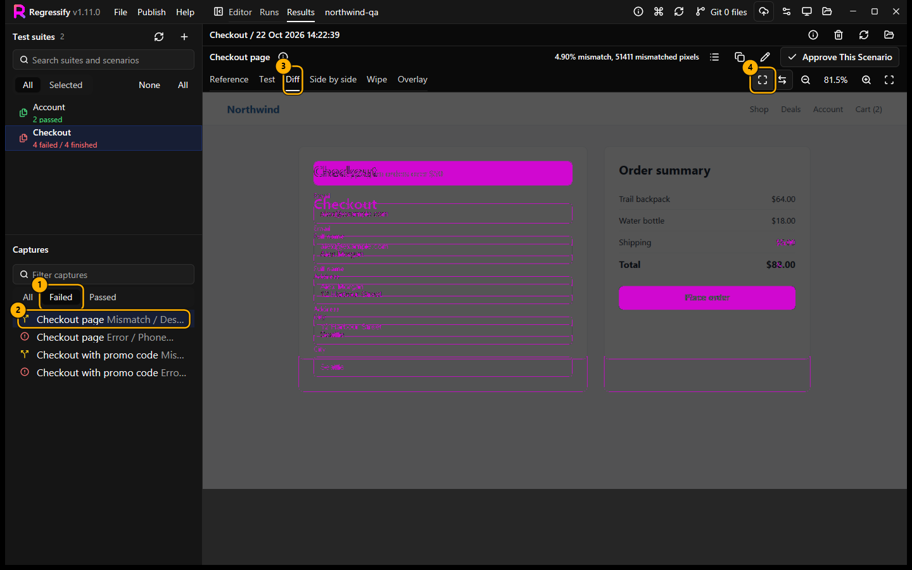

**Wipe** ① shows Reference on one side and Test on the other. Drag the **Wipe** slider ② to move the split. **Overlay** fades Test over Reference. Panes zoom and scroll
together. `Ctrl+B` widens the preview.

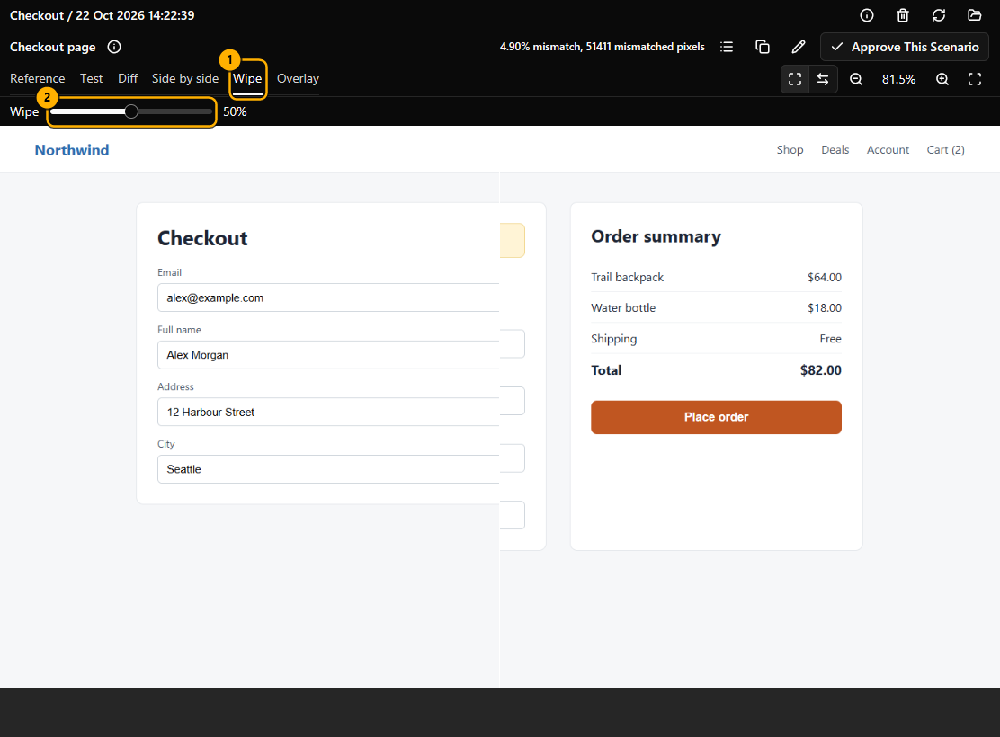

| Zoom | Button | Key |
| --- | --- | --- |
| Fit to window | **Fit to window (0)** | `0` |
| Fit width | **Fit width (W)** | `W` |
| Actual size | **Actual size (100%)** | `1` |
| Zoom 25% to 800% | **Zoom in**, **Zoom out**, `Ctrl`+wheel | `+`, `-` |
| Pan | Drag | Arrows |

Double-click an image to toggle actual size.

### Capture details

- Hover the info icon ① for selector, URLs, and diff values.
- **Copy capture details** ② copies a summary.
- **Edit suite** ③ opens the file.
- **Capture Log** ④ shows the log here.

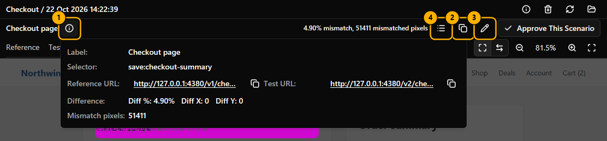

Right-click an image to open it, show it in the file manager, or copy its URL. Failed captures show an error image that
is never saved as a reference; existing references stay.

### Approve a change

1. Select the capture and click **Approve This Scenario** ①.
2. Check the viewport and run ②.
3. Click **Cancel** ③ or **Approve This Scenario** ④.

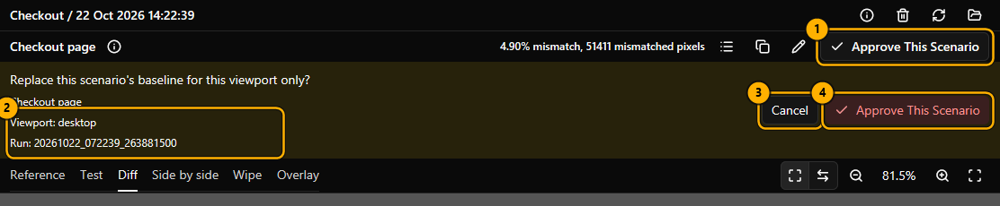

Only the viewport shown is approved. Failed captures can't be approved. Use **Approve Results** in Runs for a whole
run.

### Clean up old test runs

1. Click **Clean up old test runs** in Overview, Results, or workspace settings.
2. Set **Completed runs to keep** ① (default 1).
3. Pick suites ②.
4. Click **Preview** ③ to see what stays and the space saved.
5. Click **Delete old runs** ④, or **Close** ⑤ to delete nothing.

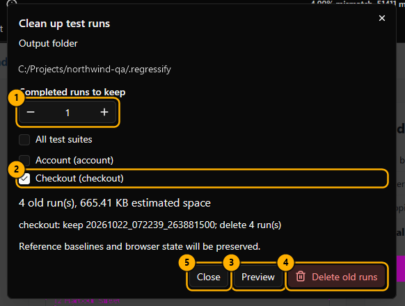

References, login state, source files, and unselected suites are never touched. Each suite keeps its latest completed
full-suite run. Stopped or incomplete runs can be removed and don't count.

For automatic cleanup, set **Automatic run cleanup** and **Test runs to keep** in Fields > Execution (off and 1 by
default; suite overrides workspace). It runs after full-suite tests, and its errors never change results.

## Git

Git must be installed. The app never asks for passwords, so set up credentials or SSH keys first. Background checks
never pull, merge, or change files.

1. Click the Git badge ① or press `Ctrl+Shift+G`.
2. Click a changed file ② to compare **Last Commit** with **Saved File** ③. Save drafts first.
3. Tick files to commit.
4. Type a **Commit message** ④.
5. Click **Commit selected files** ⑤ and confirm.

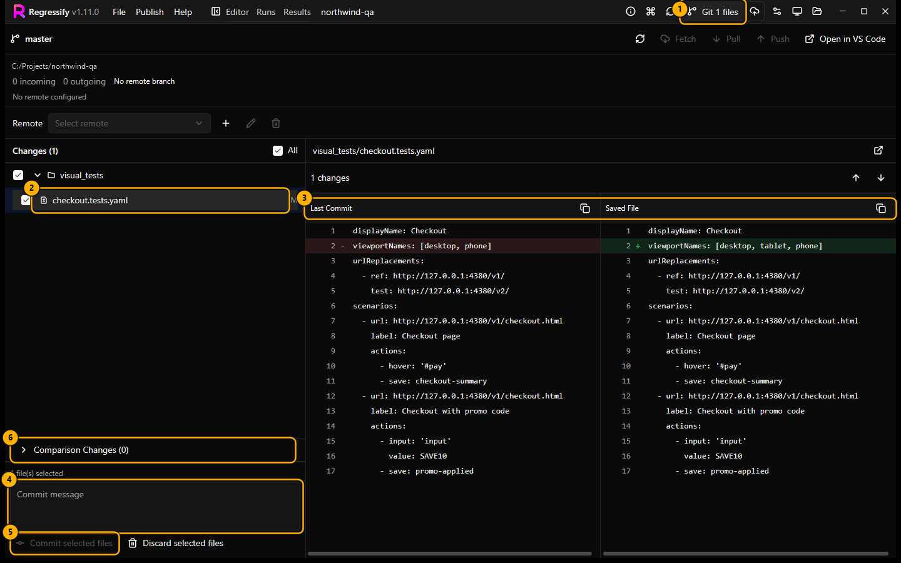

**Comparison Changes** ⑥ holds screenshots and results. It starts unselected, and **All** never selects it.

**Discard selected files** restores files and deletes selected new files. It can't be undone.

- "Not tracked": click **Initialize Git**.
- **Fetch** checks the remote now. **Pull** only fast-forwards on a clean tree. **Push** never force-pushes.
- The **Remote** row adds, renames, removes, and edits remotes.
- For conflicts, click **Open in VS Code**.

Every write asks first and can be stopped, but stopping can't undo what the remote accepted.

## Publish reports

Publish to Azure Static Web Apps, Netlify, or Cloudflare Workers without extra tools.

1. Select suites, then click **Deploy selected suite reports** ①.
2. Click **Add target** ②, enter a **Target name** ③, and pick a **Provider** ④.
3. Paste a **Deployment token** ⑤ (for Netlify or Cloudflare you can pick a saved token under **Token source**), then
   click **Save target** ⑥.
4. Click **Deploy**. For a partial selection, tick "Yes, deploy only these N of M suites".
5. Watch **Activity**, then click **Open Site**.

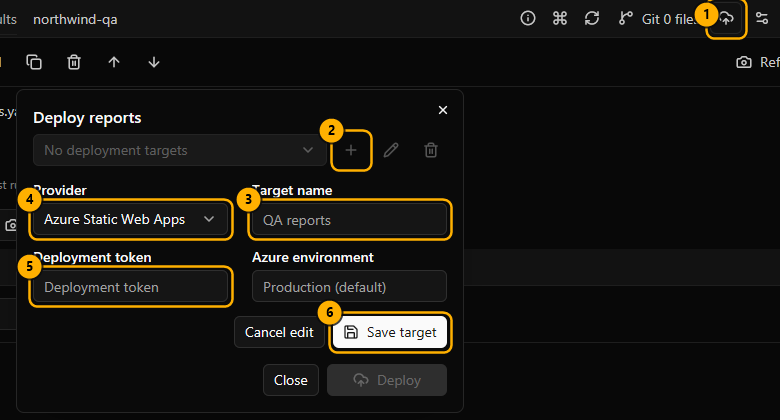

- Each suite's latest completed full-suite run is published. Partial or stopped runs aren't used.
- Source files, login state, and unrelated files aren't uploaded. Screenshots and references don't change.
- **Stop** can't undo what the provider already accepted.
- **Deployment targets** (gear) has **Copy deployed URL**. Report titles are in Run settings > Report.

| Provider | You need |
| --- | --- |
| Azure Static Web Apps | Deployment token. **Azure environment** blank means production. |
| Netlify | An existing site's **Netlify Site ID** (shown as Project ID in Netlify) and a personal access token. Deploying replaces production. |
| Cloudflare Workers | **Cloudflare Account ID**, **Worker name**, and a token with Workers Scripts Write. |

For Cloudflare, **workers.dev** can be **Public (production)** (the default, which makes the report reachable at a
public workers.dev address and needs a workers.dev subdomain), **Private**, or **Preserve existing routing**.

### Deployment tokens

**Publish** > **Deployment tokens** saves Netlify or Cloudflare tokens for all workspaces. Pick one under **Token
source**, or use **Target-specific token**. Azure tokens are per target.

Tokens are stored in the OS credential store, never in files, settings, or logs, and never shown again. Leave the
field blank to keep a token. Removing a target or token never deletes a website.

### Landing apps

A landing app lists several report sites with live pass rates.

1. Open **Publish** > **Landing apps** (no workspace needed).
2. Click **New landing app** ①, then fill in **Heading** ② and **Subheading (Markdown)** ③.
3. Click **Add site**, then enter a **Site heading** ④ and an absolute `http://` or `https://` **URL** (up to 100).
4. Click **Preview** ⑤.
5. Click **Save** ⑥, then **Deploy** ⑦.

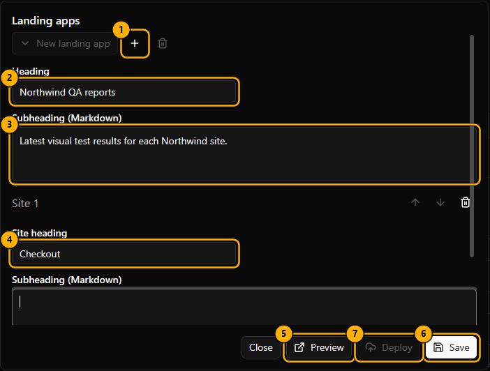

- Use `https://` sites on an HTTPS landing page; browsers may block status from `http://` sites. Private or
  login-protected reports show "Status unavailable".
- Behind Cloudflare Access, add a self-hosted Access app for `<report-host>/_snapshot/status.json` with a **Bypass**
  policy for **Everyone**. Only pass counts and a timestamp become public.
- Landing apps are saved in desktop settings. Older reports show "Status unavailable" until you regenerate and redeploy them.

Reports ask search engines not to index them but aren't private. Use your provider's access controls. Each successful
deployment sends one anonymous event; set `DO_NOT_TRACK=1` to disable it.

## Appearance and commands

### Change the theme

1. Click **Appearance** ①.
2. Choose **System**, **Light**, or **Dark** ②.

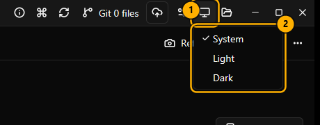

### Search commands

1. Click **Commands** ① or press `Ctrl+Shift+P`.
2. Type part of a name ②. "dark th" finds "Dark theme"; "theme dark" doesn't.
3. Press `Enter` to run the highlighted command ③.

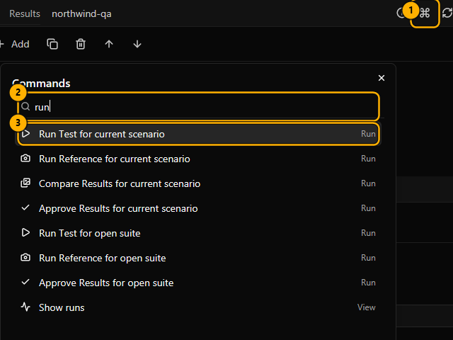

Unavailable commands are disabled. **Help** > **About** shows the version.

## Keyboard shortcuts

On macOS, use `Cmd` for `Ctrl` (not for `Ctrl+Space`) and `Option` for `Alt`.

| Shortcut | Action |
| --- | --- |
| `Ctrl+Shift+P` | Command search |
| `Ctrl+O` | Open or switch workspace |
| `Ctrl+P` | Find suite |
| `Ctrl+Shift+F` | Find setting |
| `Ctrl+B` | Show or hide the navigator |
| `Ctrl+1` / `Ctrl+2` / `Ctrl+3` | Editor / Runs / Results |
| `Ctrl+N` | New suite |
| `Ctrl+S` / `Ctrl+Shift+S` | Save / Save As |
| `Ctrl+R` | Reload from disk |
| `F5` | Refresh files |
| `Ctrl+Z` / `Ctrl+Shift+Z` | Undo / Redo |
| `Ctrl+F` | Find in Source or Log |
| `Ctrl+Space` | Suggestions in Source |
| `Ctrl+Shift+G` | Git |
| `F2` / `Delete` | Rename or delete suite |

In the Source editor:

| Shortcut | Action |
| --- | --- |
| `Ctrl+/` | Toggle YAML comment |
| `Ctrl+]` / `Ctrl+[` | Indent / Outdent |
| `Alt+Up` / `Alt+Down` | Move lines |
| `Shift+Alt+Up` / `Shift+Alt+Down` | Duplicate lines |
| `Ctrl+Shift+K` | Delete lines |

## Troubleshooting

**Run Test is disabled.** Select a suite and run **Run Reference** first.

**`regressify` isn't found.** Open a new terminal, or restart VS Code or Windows Terminal.

**Chromium didn't download.** Set **Proxy** in **Run settings**, then **More actions** > **Install Chromium**.

**My VS Code edits didn't appear.** You have unsaved edits in the app. Use **Reload from disk** or **Save As**.

**A run shows failures.** That's a result to review, not an error. Only "Command failed" is an error.

**No update banner.** It appears only after the installer downloads and passes its checksum. Click **Check for
updates**; it also retries a version that failed its checksum. Automatic checks skip a version that keeps failing its
checksum until a newer one is published. Only official Windows builds update.

**CORS error behind Cloudflare Access.** Older reports don't send your sign-in. Rerun or regenerate, then redeploy.

**"Access is denied (os error 5)" on deploy.** A local permission issue, such as Controlled folder access. Don't
disable protection or run as administrator. Report the full error, without credentials.
