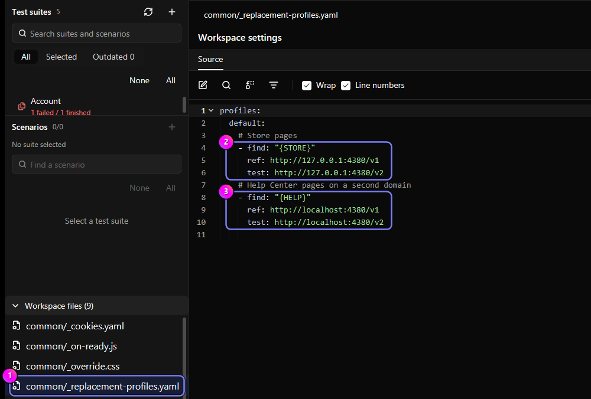
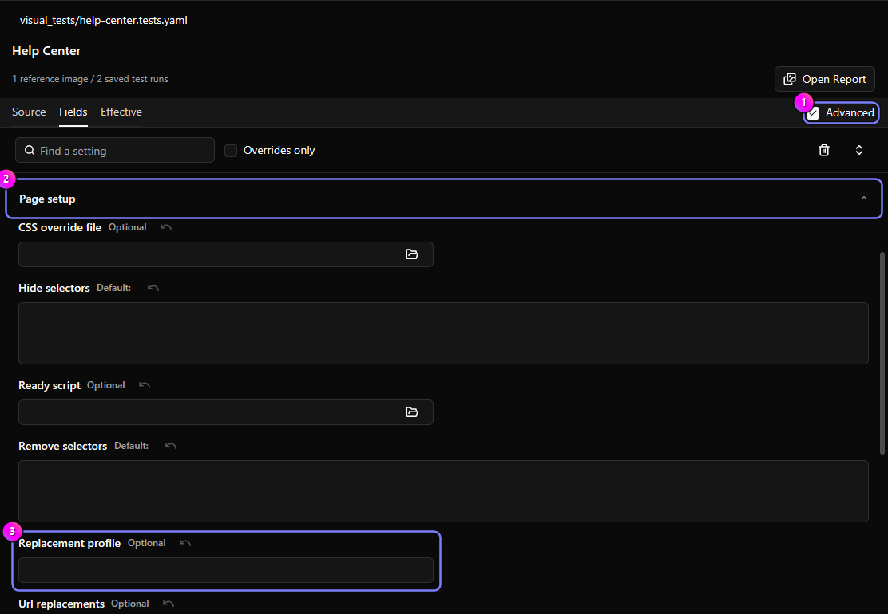
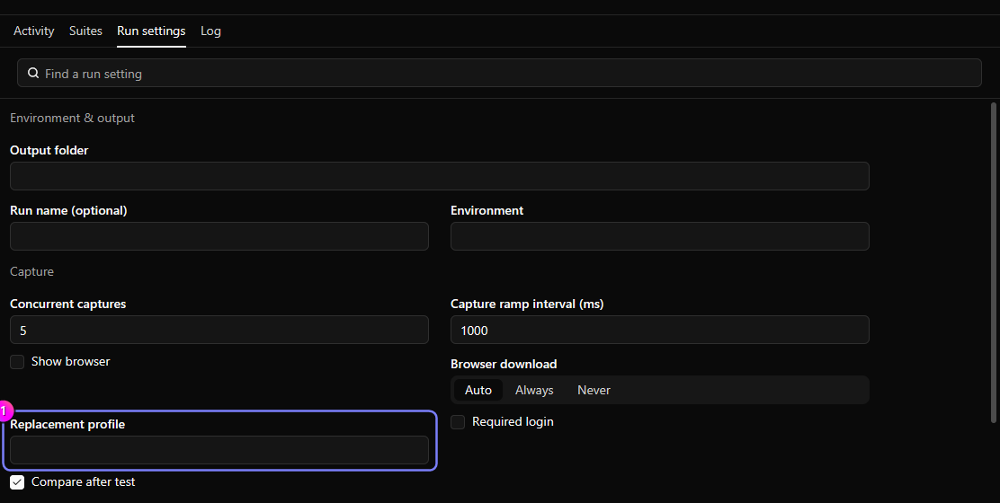

:::tip
On macOS, use `Cmd` where this page says `Ctrl`. Click any screenshot to view it full screen.
:::

You usually capture references on one environment, such as production, and run tests on another, such as staging.
URL replacement profiles change the addresses for each command, so you write a suite once and it runs on both.

## How rules work

Profiles live in `common/_replacement-profiles.yaml` (or `.yml`). A profile is a list of rules that run in order. Rules
change scenario URLs, `goto` targets, and the `url` of `wait` and `switchTab` actions.

| Rule                         | **Run Reference**             | **Run Test**                 |
| ---------------------------- | ----------------------------- | ---------------------------- |
| With `find`, `ref`, `test`   | Replaces `find` with `ref`    | Replaces `find` with `test`  |
| Only `ref` and `test`        | Leaves the URL as written     | Replaces `ref` with `test`   |

Use `find` with a placeholder such as `{STORE}` so both commands get their own address. Without `find`, write suites
with reference URLs; only tests change them.

A profile item can also be a `script` in `common/` that rewrites the whole suite, for changes a find and replace can't
make. Scripts run with your permissions, so review them like code.

## Set up a profile

1. In the navigator, open **Workspace files** and click `_replacement-profiles.yaml` ①. The app creates it with an
   empty `default` profile.
1. Add a rule for each domain ② ③.
1. Press `Ctrl+S` to save.



```yaml
profiles:
  default:
    - find: "{STORE}"
      ref: https://www.example.com
      test: https://staging.example.com
    - find: "{HELP}"
      ref: https://help.example.com
      test: https://help-staging.example.com
```

Then start scenario URLs with a placeholder:

```yaml
scenarios:
  - url: "{STORE}/checkout"
    label: Checkout
```

The editor checks each rule as you type. Every suite without its own profile uses `default`.

## Test several domains

One profile can hold a rule for every domain. A rule whose placeholder isn't in a URL changes nothing, so each suite
uses only the domains it needs. To test only the second domain, create a suite whose URLs all start with `{HELP}`:

```yaml
displayName: Help Center
scenarios:
  - url: "{HELP}/contact"
    label: Contact
```

To move every suite to another environment, change the `ref` and `test` values in one place.

## Give a suite its own profile

Add more profiles under `profiles`, then pick one for a suite:

1. Open the suite on **Fields** and turn on **Advanced** ①, or type "replacement" in **Find a setting**.
1. Find **Page setup** ②.
1. Type a profile name in **Replacement profile** ③.



A suite with its own profile ignores `default`, so that profile needs every rule the suite uses. An unknown profile name
fails the run as a configuration error.

**Url replacements**, also in **Page setup**, holds extra rules for this suite only. They run after the profile.

## Use one profile for a whole run

**Run settings** > **Replacement profile** ① applies one profile to every suite in the run. The CLI's
`--replacement-profile` option and the `REPLACEMENT_PROFILE` environment variable do the same.



:::caution
A profile chosen for the run replaces every suite's own **Replacement profile**. Leave it empty so each suite uses its
own profile, or `default`.
:::
