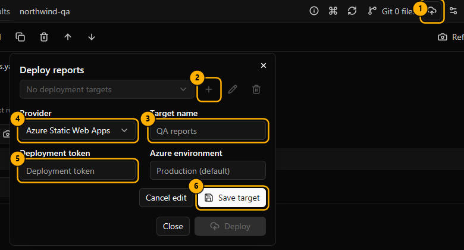
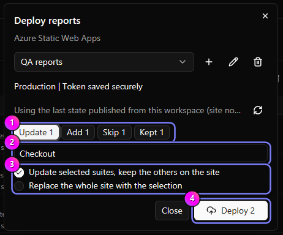
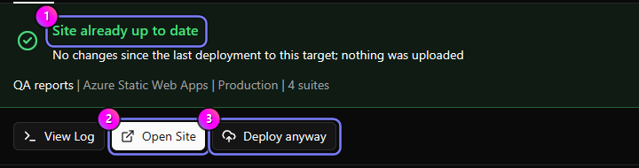
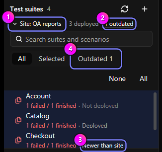
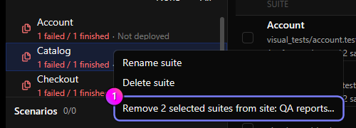
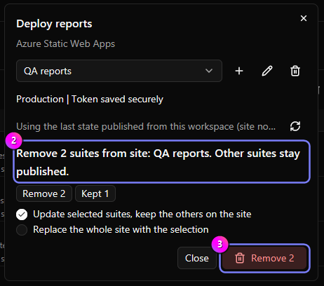
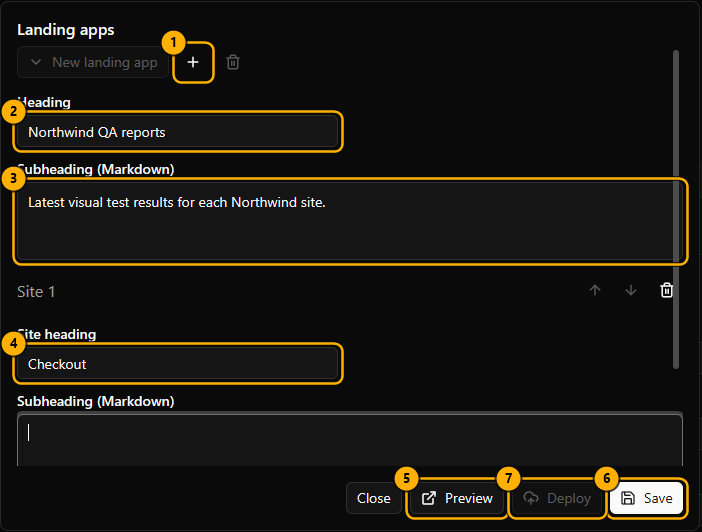

:::tip
Click any screenshot to view it full screen.
:::

Publish to Azure Static Web Apps, Netlify, or Cloudflare Workers without extra tools.

1. Select suites, then click **Deploy selected suite reports** ①.
1. Click **Add target** ②, enter a **Target name** ③, and pick a **Provider** ④.
1. Paste a **Deployment token** ⑤ (for Netlify or Cloudflare you can pick a saved token under **Token source**), then
   click **Save target** ⑥.
1. Click **Deploy**. Other suites already on the site stay there; see [Update a site](#update-a-site).
1. Watch **Activity**, then click **Open Site**.

- Each suite's latest completed full-suite run is published. Partial or stopped runs aren't used.
- Source files, login state, and unrelated files aren't uploaded. Screenshots and references don't change.
- **Stop** can't undo what the provider already accepted.
- **Deployment targets** (gear) has **Copy deployed URL**. Report titles are in Run settings > Report.

| Provider              | You need                                                                                                                            |
| --------------------- | ----------------------------------------------------------------------------------------------------------------------------------- |
| Azure Static Web Apps | Deployment token. **Azure environment** blank means production.                                                                     |
| Netlify               | An existing site's **Netlify Site ID** (shown as Project ID in Netlify) and a personal access token. Deploying replaces production. |
| Cloudflare Workers    | **Cloudflare Account ID**, **Worker name**, and a token with Workers Scripts Write.                                                 |

For Cloudflare, **workers.dev** can be **Public (production)** (the default, which makes the report reachable at a
public workers.dev address and needs a workers.dev subdomain), **Private**, or **Preserve existing routing**.

Reports ask search engines not to index them but aren't private. Use your provider's access controls. Each successful
deployment sends one anonymous event; set `DO_NOT_TRACK=1` to disable it.

## Update a site

The Deploy dialog compares your selection with the suites the site already serves.

1. Check the plan ①: **Update** (changed since it was published, or every selected suite when you replace the site),
   **Add** (not on the site yet), and **Skip** (no changes).
1. Click a count ② to list that group's suites; click it again to hide them. Long groups have a **Find a suite** search
   field.
1. Pick a mode ③. **Update selected suites** keeps every other suite on the site. **Replace the whole site** rebuilds
   and publishes only the selection; tick "I understand these N suites will be removed" to confirm.
1. Click **Deploy N** ④.

- When updating, suites that haven't changed since they were published aren't rebuilt. Netlify and Cloudflare keep
  them on the site without uploading them again. Azure Static Web Apps accepts only whole sites, so Regressify uploads
  this computer's copies of them again, after checking that they match the site. **Replace** always rebuilds the
  selected suites. If an update reports that a kept suite can't be reused, deploy with **Replace**.
- Deploy reads the list of suites from the site itself. If the site can't be read, it uses the last state published
  from this workspace, or only allows **Replace**.

### Deploy anyway

When nothing changed since the last deployment to the target, Deploy uploads nothing and finishes in moments.

1. Activity shows **Site already up to date** ①.
1. Click **Open Site** ② to view the published reports.
1. Click **Deploy anyway** ③ to rebuild and publish the same suites again.

- Use **Deploy anyway** when the site was changed from another computer or workspace, which Regressify can't detect
  from here.
- Any run, approval, or cleanup in a selected suite counts as a change, even if the reports come out the same. Deploy
  then compares the generated reports and still skips the upload when they match.

### Suite status

The **Test suites** list shows where each suite stands on the deployment target.

- **Site: _name_** ① is the target the statuses describe. Click it to choose another target.
- **N outdated** ② and the **Outdated** filter ④ show only suites with newer local results. Click **All** in that
  filter to select them for deployment.
- Each suite says **Deployed**, **Newer than site** ③ (changed locally, including an approval without a new run), or
  **Not deployed**.

### Remove suites from a site

1. Select the suites to remove, right-click one of them, and choose **Remove N selected suites from site: _name_** ①.
   Right-click a suite that isn't selected to remove only that one (**Remove from site: _name_**).
1. Check the summary ② and click **Remove N** ③. Other suites stay published.

- Selected suites that aren't on the site are ignored.
- You can't remove every suite from a site. Deploy a selection with **Replace the whole site** instead.

## Deployment tokens

**Publish** > **Deployment tokens** saves Netlify or Cloudflare tokens for all workspaces. Pick one under **Token
source**, or use **Target-specific token**. Azure tokens are per target.

Tokens are stored in the OS credential store, never in files, settings, or logs, and never shown again. Leave the
field blank to keep a token. Removing a target or token never deletes a website.

## Landing apps

A landing app lists several report sites with live pass rates.

1. Open **Publish** > **Landing apps** (no workspace needed).
1. Click **New landing app** ①, then fill in **Heading** ② and **Subheading (Markdown)** ③.
1. Click **Add site**, then enter a **Site heading** ④ and an absolute `http://` or `https://` **URL** (up to 100).
1. Click **Preview** ⑤.
1. Click **Save** ⑥, then **Deploy** ⑦.

- Use `https://` sites on an HTTPS landing page; browsers may block status from `http://` sites. Private or
  login-protected reports show "Status unavailable".
- Behind Cloudflare Access, add a self-hosted Access app for `<report-host>/_snapshot/status.json` with a **Bypass**
  policy for **Everyone**. Only pass counts and a timestamp become public.
- Landing apps are saved in desktop settings. Older reports show "Status unavailable" until you regenerate and redeploy them.
