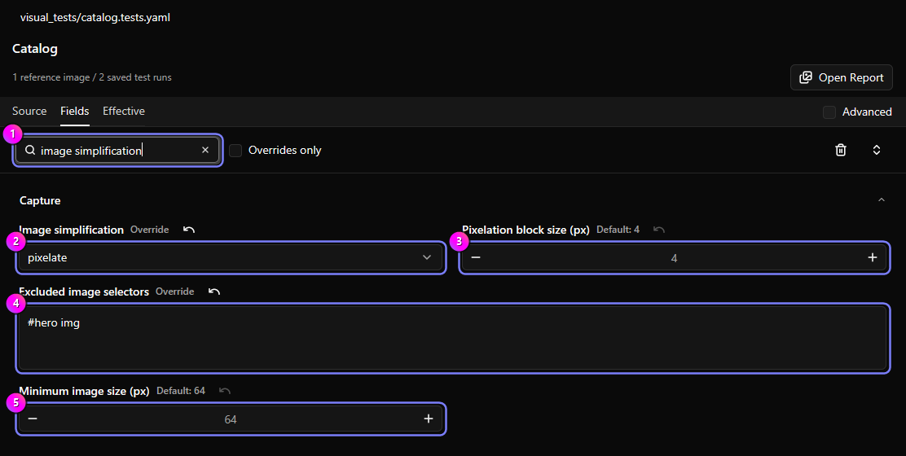
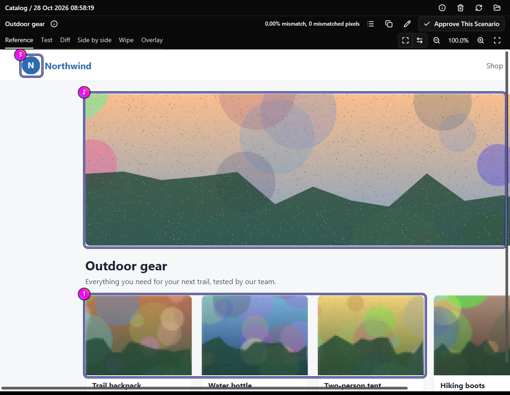

:::tip
Click any screenshot to view it full screen.
:::

Photos usually make up most of a screenshot's file size. Image simplification replaces each large image with blocks of
its average color just before each screenshot. Text, layout, icons, and logos stay sharp, and you can still recognize
every image and where it sits. On image-heavy pages, the default 4 px blocks made screenshots a quarter to a third of
their original size.

It's off by default and changes only what Regressify captures. Your site is untouched, and screenshot files are never
edited afterwards.

## Turn it on

1. Open the workspace settings, a suite, or a scenario on **Fields**.
2. Type `image simplification` in **Find a setting** ①. At the workspace or suite level you can also turn on
   **Advanced**.
3. Set **Image simplification** ② to `pixelate`.
4. If needed, change **Pixelation block size (px)** ③, **Excluded image selectors** ④, or **Minimum image size (px)**
   ⑤.
5. Save, then click **Run Reference** for the affected suites.



| Field | Default | Purpose |
| --- | --- | --- |
| **Image simplification** | `none` | `pixelate` turns it on; `none` turns it off. |
| **Pixelation block size (px)** | `4` | Block size in CSS pixels, an even number from 2 to 16. Larger blocks make smaller files. |
| **Minimum image size (px)** | `64` | Narrower or shorter images stay sharp, so icons, logos, and avatars stay crisp. |
| **Excluded image selectors** | none | CSS selectors for images, or elements containing images, that stay sharp. |

Each field resolves on its own: scenario, then suite, then workspace, then the default. To keep one scenario sharp in a
pixelated suite, set it to `none` there. An exclusion list replaces the inherited list, and an empty list clears it.
Invalid values, such as an odd block size, stop the run before any browser starts. A selector the browser can't parse
matches nothing.

In **Source**, the same settings are `imageSimplification`, `imageSimplificationBlockSize`,
`imageSimplificationMinSize`, and `imageSimplificationExcludeSelectors`. Write `none`, not `off`: YAML tools can read an
unquoted `off` as `false`.

```yaml
imageSimplification: pixelate
imageSimplificationExcludeSelectors:
  - '#hero img'
```

## What changes

In this capture, the product photos ① are pixelated, the hero image ② stays sharp because it's excluded, and the logo ③
stays sharp because it's smaller than 64 px.



Regressify simplifies images, videos (including their poster), and SVG `image` elements in the page itself that meet the
minimum size in both directions. Blocks are applied only while each screenshot is taken, including `save` checkpoints,
and the page is restored before the next action.

These stay sharp:

- images matched by **Excluded image selectors**, or inside a matching element;
- images that already have a CSS `filter`, or a border, padding, rounded corners, a box shadow, an outline, a clip path,
  or a mask;
- images that are scaled, zoomed, skewed, rotated other than in quarter turns, rotated a quarter turn while their width
  and height differ by an odd number of pixels, or moved by a fraction of a pixel;
- SVG `image` elements not placed at `x` and `y` 0, or moved by a fraction of a pixel inside their `<svg>`;
- images with something drawn on top, such as caption text, a badge, or a sticky header.

Images inside iframes or shadow DOM, canvas drawings, and CSS background images aren't simplified.

A changed image still produces different blocks, so changes are still caught. Small text inside an image, such as on a
banner, can't be read at 4 px blocks and above. Use a smaller block size, or exclude that image, when QA needs to read
it.

## After turning it on

- **Capture new references.** Turning it on, or changing any of its fields, changes the captured pixels.
- **Keep Pixel color threshold above 0.** The default 5 is fine. Inside a block, anti-aliasing detection can't excuse a
  changed pixel, so the color tolerance is the only allowance.
- **Keep reference and test settings the same.** When they differ, the comparison adds a warning to **All run logs** and
  to the report data, without changing the result. References captured before you turned it on count as `none`.
  **Results** and the web report don't mark simplified captures yet.
- **Capture references where your CI runs.** A browser can draw an image a color level or two differently between page
  loads; the color tolerance absorbs that. A GPU-rendering laptop and a software-rendering CI machine can differ by
  more, with or without image simplification.
